<div align="center">



<a href="https://github.com/zhao12yan">
  
</a>

</div>

---

## 🧙 KARAKTER KARTI · CHARACTER SHEET

| | |
|---|---|
| **İsim / Name** | Buğra Doğan |
| **Sınıf / Class** | Defense-Tech Engineer · ML Ranger |
| **Seviye / Level** | LV.3 — 3rd-year Computer Engineering @ Batman Üniversitesi |
| **Konum / Base** | 📍 Batman, Türkiye |
| **Ana Görev / Main Quest** | Savunma ve havacılık teknolojilerinde mühendis olmak 🎯 |
| **Diller / Languages** | 🇹🇷 Türkçe (native) · 🇬🇧 English |

```text
╔══════════════════ STATS ══════════════════╗
║  Computer Vision   ██████████████░░░░  75 ║
║  Machine Learning  █████████████░░░░░  70 ║
║  Backend / APIs    ████████████░░░░░░  65 ║
║  Frontend          ██████████░░░░░░░░  55 ║
║  Embedded / Robot  ██████████░░░░░░░░  55 ║
║  Team Leadership   █████████████░░░░░  70 ║
╚═══════════════════════════════════════════╝
```

---

## 🎒 ENVANTER · INVENTORY

<p align="center">
  
</p>

<details>
<summary><b>⚔️ Silahlar & Büyüler (genişlet)</b></summary>

| Slot | Item | Kullanım |
|---|---|---|
| 🗡️ Ana Silah | Python · YOLO · OpenCV | Nesne tespiti, görüntü işleme |
| 🛡️ Zırh | ASP.NET Core · Node.js · Rust (Axum) | Backend & REST API |
| 🔮 Büyü Kitabı | TensorFlow / Keras · scikit-learn | Sınıflandırma, tahmin modelleri |
| 🏹 Yan Silah | React · TypeScript | Arayüz geliştirme |
| 🔧 Alet | PIC16F877A Assembly | Gömülü sistemler |

</details>

---

## 📜 GÖREV KAYDI · QUEST LOG

| Durum | Görev | Açıklama | Ödül (Stack) |
|:---:|---|---|---|
| ⚔️ **AKTİF** | **BitkilenAI** — *Bitirme Projesi* | Bitki hastalığı tespit uygulaması | MobileNetV2 · OpenCV · Streamlit |
| ⚔️ **AKTİF** | **xView Object Detection** | Hava görüntülerinde küçük nesne tespiti (SAHI) | YOLO11 · Python |
| ⚔️ **AKTİF** | **BelediyeBaşvuru** — *👑 Takım Lideri* | Vatandaş şikâyet portalı (5 kişilik ekip) | ASP.NET Core MVC |
| ✅ TAMAMLANDI | [**olist-churn-prediction**](https://github.com/zhao12yan/olist-churn-prediction) | Churn tahmini ve tavsiye sistemi | Jupyter · ML |
| ✅ TAMAMLANDI | [**tirfilo**](https://github.com/zhao12yan/tirfilo) | Tır & filo yönetim platformu | JavaScript |
| ✅ TAMAMLANDI | [**grocery-delivery**](https://github.com/zhao12yan/grocery-delivery) | Market teslimat uygulaması | TypeScript |
| ✅ TAMAMLANDI | [**mailoto**](https://github.com/zhao12yan/mailoto) | Mail otomasyonu | JavaScript |

---

## 🏆 BAŞARIMLAR · ACHIEVEMENTS

| | |
|---|---|
| 🤖 **Robot Savaşçısı** | TEKNOFEST robotik deneyimi |
| 💡 **Knight Rider** | PIC16F877A Assembly ile LED efekti |
| 👑 **Parti Lideri** | 5 kişilik yazılım ekibine liderlik |
| 🎓 **Final Boss Hazırlığı** | Bitirme projesi seçildi: BitkilenAI |

---

## 📊 SAVAŞ İSTATİSTİKLERİ · BATTLE STATS

<p align="center">
  
  
</p>

<p align="center">
  <picture>
    <source media="(prefers-color-scheme: dark)" srcset="https://raw.githubusercontent.com/zhao12yan/zhao12yan/output/github-snake-dark.svg"/>
    
  </picture>
</p>

---

<div align="center">

```text
 ┌──────────────────────────────────────┐
 │   PARTİYE KATIL? · JOIN THE PARTY?   │
 │        ▶ YES          NO             │
 └──────────────────────────────────────┘
```

<a href="mailto:bugradogan123456789@gmail.com"></a>


</div>
